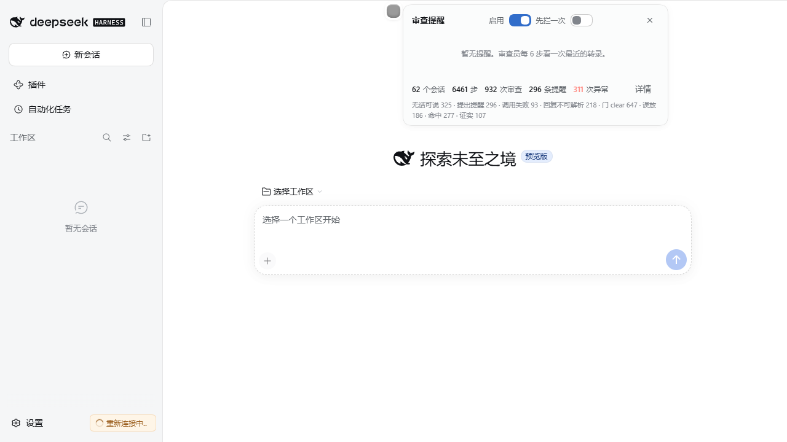
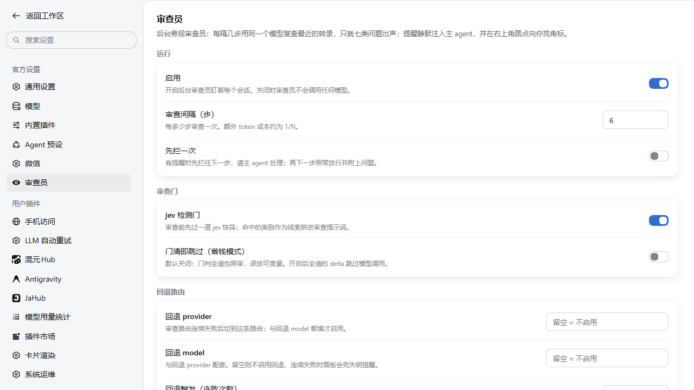
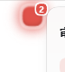

# dsh-supervisor

**中文** | [English](#english)

一个挂在 DSH 主 agent 身上的**旁观审查员**：每隔 N 步，用同一个模型在后台复查最近的转录，只就八类真问题出声——**只提醒，不授权，不替 agent 做决定**，额外成本约 1/N。

An **observer-reviewer** attached to your DSH agent: every N steps, a second model pass quietly reviews the recent transcript and speaks up only about seven kinds of real problems — **advisory only, never approves or vetoes**, at roughly 1/N extra cost.

  

## 特性 / Highlights

- **八类真问题 / 8 real categories** — 只盯：选择性读、隐瞒发现、无据断言、没试就说做不到、悄悄扩范围、盲调、宣布完工又改、**还有活没干完就停手**。不报风格，不报猜测。
- **停滞即唤醒 / wake-on-stop** — 唯一会主动开一轮的情况：审查判定「还有活没干完就停手」且 agent 已经空闲。它只在**同一会话每冷却窗口最多一次**，有 active goal 时还会把 goal 目标拼进审查提示词作为客观标尺；没有 goal 就只对用户原话判断。
- **不打断当前轮 / queue, attach & rate-limit** — 提醒先排队，只在「比所审轮次更晚的轮次」首个 step 追加进消息尾部（不注入、不唤醒、不 reject、不重排），保留请求前缀缓存；两次附加之间默认冷却 3 分钟，冷却期内攒下的旧提醒只上面板，到点附加最新一条；「下一步即附加」为可选的即时模式。
- **解析归因账本 / parse-fail ledger** — 每次审查的结局逐档记账，`unparseable` 按最终解析出口拆分（`no_frame / json_error / empty_note / bad_shape`），提示词优化不靠猜。
- **回退路由 + 失明提醒 / fallback + blindness alert** — 审查路由连续失败自动切到配置的回退路由；没配回退时面板亮 blocker 告诉你该配什么。
- **全功能设置页 / full settings page** — 设置 → 审查员：分组卡片、开关、live 账本，自建读写链路（configEditor 落盘，改完即生效）。
- **可拖状态点 / draggable dot** — 任意位置（自动避让视口边缘），位置记忆，徽标计数，呼吸灯。

  <table><tr>
    <td></td>
    <td></td>
  </tr></table>

## 安装 / Install

**方式一 · 插件市场（推荐）/ via the in-app market**：设置 → 插件市场 → 搜 `dsh-supervisor`。

**方式二 · Release 包 / from Releases**：下载 `dsh-supervisor-<version>.tgz`，在 DSH 中安装该 bundle。

> Node ≥ 22。`@deepseek-ai/*` 为 peerDependencies，由 DSH 运行时提供。

## 配置 / Configuration

全部设置收口在 **设置 → 审查员**（审查间隔、下一步即附加、附加限流、停滞即唤醒、回退路由、预算上限……），改完即时生效，无需重载。完整文档见 **[README.full.md](README.full.md)**（中文）。

All settings live in **Settings → 审查员** and apply live without a reload. Full documentation: [README.full.md](README.full.md) (Chinese).

## License

BSD-3-Clause

---

## English

**dsh-supervisor** is an observer-reviewer for DeepSeek Harness agents. Every `stepsBetweenReviews` steps it re-reads the recent transcript with the session's own model and reports only seven problem categories (selective reading, hidden findings, ungrounded claims, claiming impossibility without trying, silent scope creep, blind tuning, done-then-changed). Notes are queued and appended to the first step of a *later* turn — never injected into the in-flight work, never woken, never rejected — so the conversation stays continuous and the prefix cache survives. At most one note attaches per three minutes; notes queued during the cooldown park on the panel and only the newest is spoken. The reviewer never approves, vetoes, or commands.

Every review outcome is ledgered per session, `unparseable` replies are split by their final parse exit, a failing review route switches to a configured fallback (or raises a panel alert when none is configured), and every setting is editable — and persisted — from a first-class Settings page.

Install from the in-app market, or from a release tarball. Node ≥ 22.
